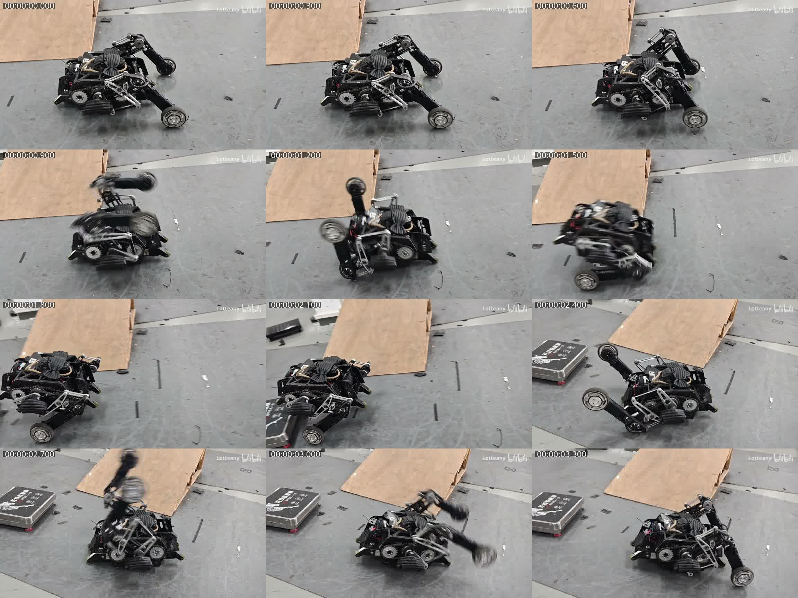
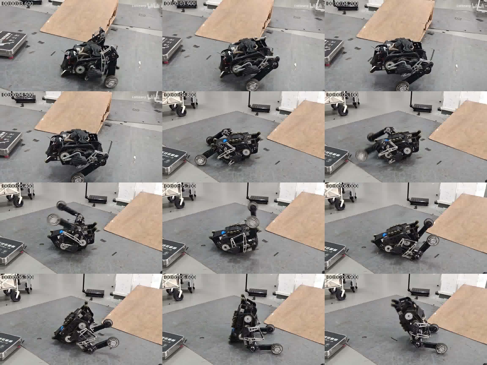
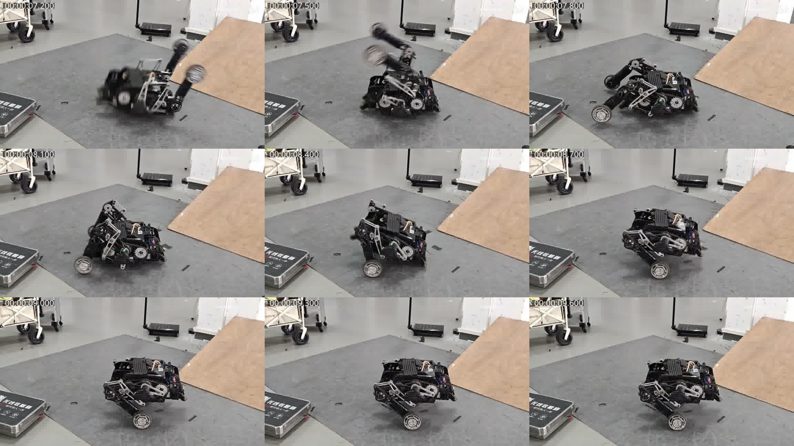

# 参考视频每 0.3 秒观察记录

源文件：`/home/noir/Downloads/轮腿倒地自起姿态参考视频.mp4`。
SHA-256：`ee3592b2fa546e4d20d6b14a671a57ee881e03f653a3334d0f072eb4211aa322`。
30 fps、9.866625 s；取 0.0–9.6 s 共 33 帧。三张接触表按行读取，时间直接标在画面上。

```sh
ffmpeg -i '/home/noir/Downloads/轮腿倒地自起姿态参考视频.mp4' \
  -vf "fps=10/3,scale=768:-1,drawtext=text='%{pts\:hms}':x=8:y=8:fontsize=24:fontcolor=white:box=1:boxcolor=black@0.6" \
  frame_%03d.jpg
```

以下是图像中的定性观察，不用单视角像素估计本车关节零点或力矩；前后名称需要另外按 CAD 的 +X 对齐。

| 时间 / s | 观察 |
| --- | --- |
| 0.0 | 第一种正趴初态，双腿位于车体一侧，车身贴地。 |
| 0.3 | 初态保持，开始准备动作。 |
| 0.6 | 髋部开始带腿抬起，连杆形状变化。 |
| 0.9 | 双腿快速绕过车体上方。 |
| 1.2 | 腿继续翻向另一侧，轮仍高于车身。 |
| 1.5 | 轮向地面运动，车体开始离开贴地状态。 |
| 1.8 | 落轮后膝部明显折回，车身保持较低姿态。 |
| 2.1 | 缩腿后的支撑姿态保持。 |
| 2.4 | 第二种正趴初态，双腿在相反一侧，轮抬起。 |
| 2.7 | 双腿从这一侧绕向车体上方。 |
| 3.0 | 继续绕到另一侧，轮开始向地面摆落。 |
| 3.3 | 腿伸出准备承重，车体尚低。 |
| 3.6 | 轮承重并抬车，车体仍有倾斜。 |
| 3.9 | 膝部折回、车身回正，不能继续保持最大腿长。 |
| 4.2 | 缩腿后的支撑姿态保持，倾斜减小。 |
| 4.5 | 第二段动作结束，随后切换初态。 |
| 4.8 | 第三种倒扣/倾倒初态，尚不能直接进入站姿控制。 |
| 5.1 | 开始摆腿，改变顶地位置。 |
| 5.4 | 双腿继续经过上方，车体仍倒扣。 |
| 5.7 | 轮和腿向另一侧运动，为翻身准备支撑。 |
| 6.0 | 腿伸出，开始利用支撑改变车体姿态。 |
| 6.3 | 车体绕支撑边抬起，轮逐渐接近地面。 |
| 6.6 | 车身达到大倾角，腿仍在提供翻转支撑。 |
| 6.9 | 继续越过翻身阶段，尚未达到平稳站立。 |
| 7.2 | 车身再次落向正趴状态，需要重新执行起身过程。 |
| 7.5 | 双腿重新摆到上方，不能把前一次翻身结束判成自起完成。 |
| 7.8 | 已回到正趴起身过程，腿向支撑侧摆下。 |
| 8.1 | 轮接地抬车，膝部开始折回。 |
| 8.4 | 接地末段继续缩腿，控制车体姿态。 |
| 8.7 | 车体回正，腿保持收短后的支撑形状。 |
| 9.0 | 姿态基本稳定，未继续伸到最大腿长。 |
| 9.3 | 保持稳定支撑。 |
| 9.6 | 保持稳定支撑至视频末段。 |

实现中的关键时序：先保留长腿完成抬车，再在最后落轮弧段主动屈膝，随后进入低速接稳和连续稳定判定。将缩腿放在整个落轮动作之后太晚；从落轮一开始就一直缩腿又可能让车身后缘重新撑地。48°、105°和20°是 v202 仿真候选命令值，不是视频量角结果。




