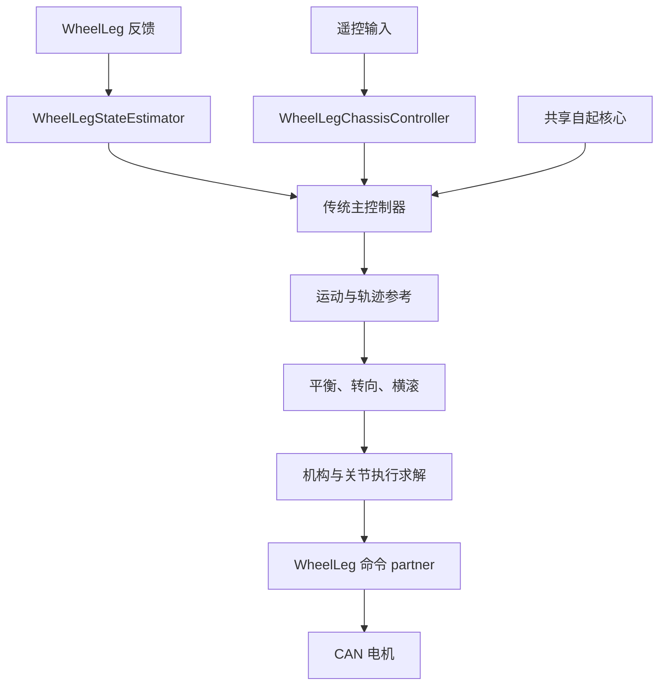
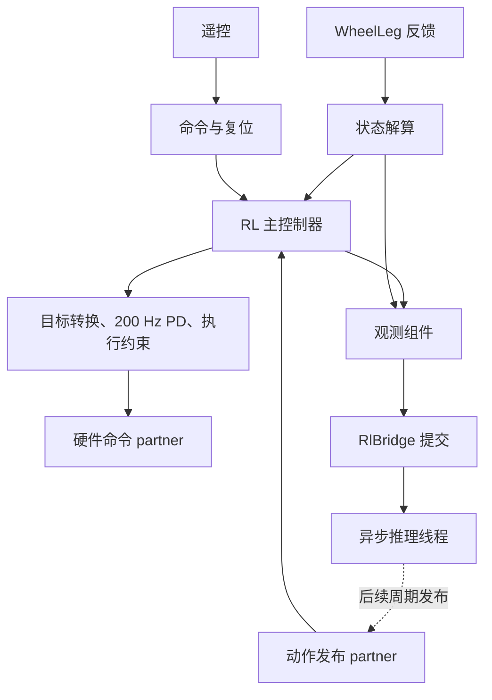

# 轮腿代码重构

本次在独立 `dev/wheel-leg-refactor` 工作树实施，基线为 RMCS `7add701a`、
`rmcs_rl` `a5912385b9d1766606b8c34b3fe5bc16f94e85ab`。原工作树的 WheelBipe
配置、DM 调度修改和传统工作树未提交的最新自起实现均先保存快照，再纳入迁移。
本任务未改写原工作树；实施期间原 RMCS 工作区另有并行的 12500 模型/诊断修改，
该批变化不在本次启动时快照内，未静默合入。源码与固定输入输出的出处见
[基线回放说明](../../rmcs_ws/src/rmcs_core/test/fixtures/wheel_leg/README.md)。

## 启动入口

| 配置 | 唯一主控制器 | Executor / PD / 策略 |
| --- | --- | --- |
| `wheel-leg-infantry-traditional.yaml` | `WheelLegController` | 1000 / 1000 / 无，Hz |
| `wheel-leg-infantry-prone-v4.yaml` | `WheelLegRlController`，ProneMotion | 1000 / 200 / 100，Hz |
| `wheel-leg-infantry-wheelbipe.yaml` | `WheelLegRlController`，WheelBipe | 1000 / 200 / 50，Hz |

每次选一个 YAML。三个入口共用 `hardware::WheelLeg`、遥控组件、状态解算和执行基础。
不提供运行中的传统/RL 切换或混控。`wheel-leg-infantry-wheelbipe-recovery.yaml`
仍用于 8500 候选的仿真自起交接，它使用相同主控制器和适配器，不增加第四种架构。
该配置启用脚本自起且保留仿真限制：必须由仿真源提供 `/wheel_leg/simulation=true`，
实物硬件组件不提供这个标记，不能直接把该文件作为实车启动入口。

## 代码结构与职责

```text
rmcs_core/src/
  hardware/
    wheel_leg.cpp                    板卡、反馈、协议与驱动使能
    util/wheel_leg_drive.hpp          时隙、清错、使能确认、重试、立即失能
  controller/chassis/
    wheel_leg_chassis_controller.cpp  遥控仲裁、使能意图与复位事件
    wheel_leg_state_estimator.cpp     主动轴连续角、姿态及被动机构状态
    wheel_leg_controller.cpp          传统阶段、求解顺序与最终输出
    wheel_leg_rl_controller.cpp       RL 阶段、自起交接、动作转换与 PD
    wheel_leg_observation.cpp         策略采样、历史、ProneMotion 里程计
    wheel_leg/
      joint_coordinates.hpp          唯一六轴顺序与坐标定义
      leg_kinematics.hpp             被动机构正逆解
      joint_solver.hpp               PD、前馈与最终执行约束
      motion_planner.hpp             运动参考与原有离散轨迹算法
      balance_solver.hpp             平衡、转向、横滚和积分修正
      self_righting.hpp              最新传统自起核心及统一设置
      gas_spring.hpp                 当前气簧补偿
      model/                         标定、机械参数、冻结观测几何
      policy/prone_motion.hpp        ProneMotion 观测适配
      policy/wheelbipe.hpp            WheelBipe 观测适配
```

每个可加载组件在一个 `.cpp` 中完整定义，构造函数直接注册接口。
算法类可持有滤波、轨迹和积分状态，由主控制器按明确顺序调用。
`model/` 中的大型几何表分别被机构、气簧和冻结观测实际使用，保留这些数据。
离线 CAD 表生成器 `sync_wheel_leg_calibration.py` 仅生成冻结机械数据，不连接硬件；
实验标定控制入口已删除。

`rmcs_rl` 继续独立维护：通用模型加载、元数据要求、异步工作线程、结果有效性及
跨复位隔离。轮腿专用 `model_type` 已删除，YAML 使用 `mlp`，任意模型元数据通过
`expected_metadata.<key>` 精确校验。轮腿机构和具体策略差异留在 `rmcs_core`。

## 数据流和时序



传统主控制器直接拥有阶段：1 待机、2 等待驱动、3 正常控制、4 自起。
正常路径在 `update()` 依次执行运动规划、轨迹、平衡、机构逆解、连续目标和 PD。
传统参数、低通离散形式及轨迹时钟保留；横滚微分仍是原来的逐周期差分。
双中先执行 0.5 秒准备，右 UP 允许轮平衡；RL 的双中准备时间为 0。



观测组件拥有 100/50 Hz 采样时钟，新帧序号触发推理。主控制器接受新动作目标，
每 5 个 executor 周期重算力矩，间隔内保持。只有实际进入 PD 的动作才写入
`/wheel_leg/rl/applied_action`，随后观测读取该历史。WheelBipe 历史保持原始值，
物理轮速 ±90 rad/s 限幅不会反写历史；ProneMotion 保留原裁剪与初始化语义。

动作发布 partner 读取之前提交的异步结果，使组件依赖保持单向。复位由
`/chassis/reset_count` 同时到达状态、主控制器、观测和推理链；publisher 在主控制器
之前拒绝旧代次结果。推理超时按请求提交时间计算，重复观测不刷新时龄。

## 坐标与边界所有权

内部六轴固定为左髋、左主动膝驱动轴、右髋、右主动膝驱动轴、左轮、右轮。
WheelBipe 的策略排列在 YAML 动作映射和观测适配器中显式转换。
被动膝内角使用 `passive_knee`，不与电机主动轴角混称。

```text
原始协议 → 驱动安装方向/编码器零点/减速比 → 硬件输出轴
        → joint_coordinates 与机构状态 → 控制算法
        → JointSolver 约束/坐标回映 → 设备编码 → CAN
```

腿模型坐标为 `q_model=-q_api+offset`，四轴 offset 为
`[1.6, 3.0282761689183353, -1.6, -3.0283102010168]` rad。
力矩使用该映射的转置雅可比；轮侧减速比保持 15.62。
IMU 安装变换和杆臂补偿仅在硬件采样链处理一次。
机械域 40°–110°、110° 置零与 ProneMotion 冻结的 107° 策略投影分别定义。
当前模型、几何和 ONNX 权重未借结构重构重新标定或训练。

| 检查 | 所有者 |
| --- | --- |
| 配置、维度、频率和模型元数据 | 构造、模型加载、接口配对 |
| CAN/IMU/DR16 时效、驱动清错与确认 | 硬件采样和驱动 |
| 有限输入、连续角与机构状态 | 状态解算 |
| 推理失败、过期、复位代次 | 通用推理桥 |
| 当前阶段与是否允许输出 | 唯一主控制器 |
| 机构向外力矩、整组缩放与电机限幅 | 关节求解、设备编码 |

CAN/IMU 采用硬件统一 40 ms 门；原硬件 50 ms 与控制器 40 ms 重复检查已合并，
等待初次驱动就绪也受该门约束。DR16 为 100 ms。DM 保留左右交替 500 Hz 调度和
清错/使能重试，显式停机立即发四路失能及中性 MIT。腿控制不再发送内置位置 PD。

双 DOWN 与断连撤销输出、清除遥控状态；重新使能必须重新经过双下准备。
主控制器复位清空目标、滤波、轨迹、积分、航向、自起和执行历史；状态解算重建
连续角与里程，观测复位局部里程计和历史，推理链切换代次并清空缓存。
状态故障、推理失败和超时清零并锁存，双下解除。故障原因记录在日志，运行阶段、
自起 fault 和 DM status/fault 保留可查询接口。

## 自起迁移与退役内容

统一采用传统工作区最新核心：姿态路由、独立多圈主动轴反馈、105° 支撑、落地末段
20° 收至 48°，以及连续稳定后的交接。传统主控制器与 RL 主控制器均独占自起输出。
默认关闭；`simulation_only=true`、`hardware_mapping_verified=false` 保留。
RL 在自起完成、姿态/速度/目标误差满足捕获条件后才启动对应策略，新有效动作到达后交接。
这项行为迁移独立于观测/动作数值等价验证；原倒置失败的超速保护没有删除。

删除旧 V5/V6/standing/早期策略、旧 controller/wheelleg 目录、分散的组件成员函数实现、
重复 arm/reference 状态、单侧/轮端辨识、实验标定/专用记录器/预览工具及独占消息。
同步移除插件、YAML、构建目标和退役模型。通用设备 API、其他机器人消费者以及当前
机构和冻结观测需要的表保留。历史报告不被改写成新实现的通过证明。

## 验证与限制

在开发容器中通过仓库脚本构建：

```sh
build-rmcs --packages-select rmcs_msgs rmcs_rl rmcs_core rmcs_bringup --cmake-args -DBUILD_TESTING=ON
cd rmcs_ws
colcon test --merge-install --packages-select rmcs_core rmcs_rl --return-code-on-test-failure
colcon test-result --test-result-base build/rmcs_core --verbose
colcon test-result --test-result-base build/rmcs_rl --verbose
```

本次实际构建四包通过；core 14 个 CTest 入口、rl 2 个入口全部通过。
`colcon test-result` 汇总为 core 45、rl 11 项（包含 CTest 与其内部 gtest 结果，不能相加作独立用例数）。

- 三个正式 YAML 使用真实 pluginlib 类、真实 executor 和实际 ONNX 工作线程完成配对和调度。
  硬件由内存传感器替代；覆盖准备/使能、双下、断连、反馈超时、动作过期、故障和重使能。
- 保存的旧实现对照：每策略 240 帧观测、24 组气簧、1200 帧传统轨迹、384 组动作到最终
  API 力矩，覆盖多圈角、边界、限幅和不同关节上限。观测/气簧同平台逐值一致，轨迹和执行容差 1e-12。
- 两套 RL 入口另外验证 200 Hz PD、100/50 Hz 观测以及“PD 后才更新历史”；
  异步复位测试在首请求后立即复位并禁用，旧请求返回也不能恢复有效动作。
- 与训练 Python 对照：ProneMotion 4778 帧、WheelBipe 256 帧、气簧 1201 组，
  并通过 C++ ONNX 路径核对 239/256 个样本，错误 profile 模型均被拒绝。
- 通用推理桥继续运行其他机器人真实 Deformable transformer 插件集成回归并通过。

自起使用新共享恢复 ABI 做原生 Isaac PhysX 回归；30° 前倾、正趴和反趴恢复后各完成 20 秒传统站立，
倒置场景保留 `recovery_fault_3`，没有交接。详细场景结果见
[验证回执](../../rmcs_ws/src/rmcs_core/test/fixtures/wheel_leg/validation.json)。
这些原生探针的恢复核心来自新代码，交接后的整车传统控制仍使用既有 native 控制器；
**它们不等同于新 ROS 传统主控制器的整车动态验证**。新主控制器已有插件回放和算法
基线对照，实物映射、整车动态及长期成功率仍需后续测试。

本次未连接实物板卡、发送 CAN、运行 PPO 或改变训练进程。没有据此将任何模型或控制链
标为行为/硬件 qualified。气簧区间外推和右侧对称仍是已有模型假设。
