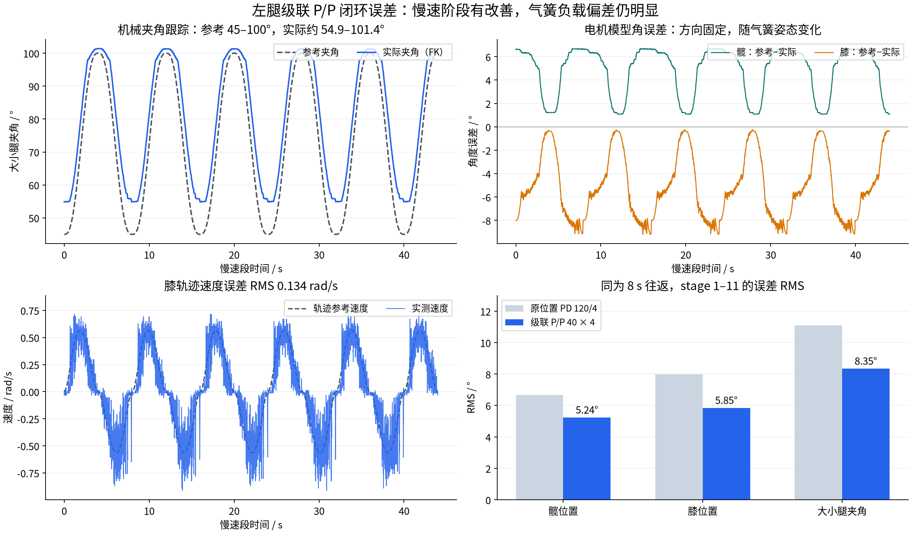

# 左腿级联 P/P 闭环误差

原始记录：`/home/noir/wheel_leg_joints_2026-10-27_14-13-22.csv`。
112144 行、268 列，未发现字段不齐的行。原始 CSV 未修改。

分析只取左腿 run 1 / mode 2 的完整 stage 1–11：43705 个样本，约 44 s。
每个单向运动 4 s、往返 8 s。初始 5 s 转移和只运行 0.152 s 的 stage 12 不计入主指标。
实际记录参数为位置 P=40 /s、速度 P=4 N·m·s/rad，速度目标限幅 8.5 rad/s、最终力矩限幅 40 N·m。

| 指标 | 髋电机模型角 | 膝电机模型角 | 大小腿实际夹角 |
|---|---:|---:|---:|
| 误差 RMS | 5.238° | 5.848° | 8.347° |
| 平均有符号误差 | +4.803° | −5.143° | +7.625° |
| 绝对误差 P95 | 6.666° | 8.719° | 11.289° |
| 最大绝对误差 | 6.688° | 9.194° | 11.666° |

电机误差定义为模型坐标中的“参考−实际”；大小腿夹角误差定义为“实际−参考”。
夹角来自编码器与现有闭链 FK，不是独立角度传感器。
参考夹角为 45–100°，实际为 54.893–101.381°。
参考在 45±0.5° 时，实际平均约 55.26°；参考在 75±0.5° 时，实际平均约 84.73°。

两个关节均未触及力矩限幅或速度目标限幅。命令峰值分别为 19.13、25.96 N·m。
膝轨迹速度误差 RMS 为 0.134 rad/s；内环速度误差还包含位置环为抵消负载而产生的速度目标，不能混用两个指标。
训练和后半段的夹角误差 RMS 分别为 8.407°、8.274°，主要表现为可重复的姿态相关偏差。

在限幅不触发时，本次 P/P 等价于 `tau=160*(q_ref-q)+4*(dq_ref-dq)`。
它仍要靠位置偏差产生气簧平衡力矩，不会因改成双环自动消除恒定负载误差。

## 同轨迹旧记录比较

对照来源：`/home/noir/Documents/workspace/wheel_leg扫频/wheel_leg_膝关节气簧辨识数据.csv`，
同为左腿 run 1 / mode 2、stage 1–11、4 s 单向运动；旧参数为位置 PD 120/4。
旧文件最后一行截断，按已有原始文件哈希核验的审计记录排除第 218311 行。

| RMS | 旧位置 PD 120/4 | 本次级联 P/P 40×4 | 降低 |
|---|---:|---:|---:|
| 髋模型角 | 6.674° | 5.238° | 21.5% |
| 膝模型角 | 7.983° | 5.848° | 26.7% |
| 大小腿夹角 | 11.087° | 8.347° | 24.7% |

这是两份同协议记录的比较，改善幅度与等效位置刚度从 120 增加到 160 相符，不能单独归因于级联结构。

## 时序与结论边界

主分析段更新间隔中位数 1.000 ms、P99 1.118 ms；有 8 次约 38 ms 的间隔，
多数间隔之间相距约 5 s。控制计算本身中位数 2.409 us、最大 413 us，间隔前一次计算仅为数 us。
该现象需要在执行器调度、采集和日志链路排查，现有数据没有定位到具体代码，不能把它直接当成电机延迟。
旧记录中也存在相似间隔。

这份记录没有完成整个扫频，没有高速段、局部 chirp 或右腿结果。
现阶段优先按实际夹角估计并补偿平均气簧负载，再判断剩余的摩擦、阻尼和动态误差。
气簧拟合及独立验证见 [建模报告](../leg_gas_spring_model_20261027/README.md)。

完整数值、阶段选择、源文件哈希和时间戳间隔见 [metrics.json](metrics.json)。
复现：使用安装了 NumPy/Pandas 的 Python 运行本目录 `analyze.py`；绘图调用本机 `/usr/bin/python3 plot.py`。
