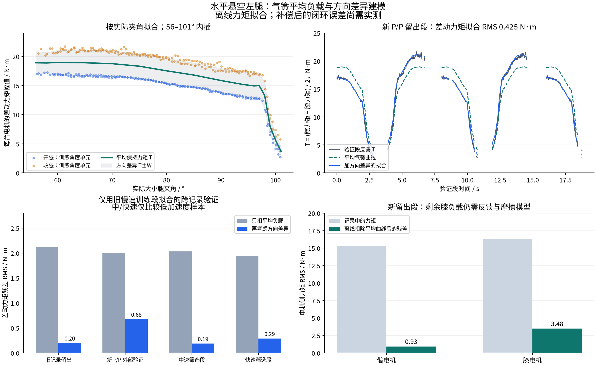

# 水平悬空左腿：气簧保持力矩建模

已用旧慢速扫频和新级联 P/P 记录拟合一版**实际大小腿夹角 → 左腿电机侧平均保持力矩**表，
并把后半段留作独立验证。它可以作为气簧前馈候选；当前完成的是离线拟合，没有改变运行控制器或电机输出。

## 这批慢速数据测到了什么

按用户确认，腿水平悬空、无外载，不需要加入重力力矩。
电机所需力矩仍包含气簧、密封/轴承/传动摩擦、气簧方向滞回和自身惯性。
低速且加速度较小时，主要是气簧保持力矩和摩擦；加减速及换向不能直接当作静态气簧数据。
停住时，静摩擦可以在一个区间内平衡负载，不能由一个静止点唯一分离气簧和静摩擦。

气簧本身也有密封摩擦及运动阻尼，压缩和伸长的作用力会不同，见
[SUSPA 气簧原理与摩擦说明](https://www.suspa.com/global/products/gas-struts/faq/)。
本报告的正反向差异因此称为“方向半宽”，不把它直接当成电机摩擦系数或纯气簧密封摩擦。

## 数据与验证划分

| 来源 | 使用阶段 | 训练 | 留出验证 |
|---|---|---|---|
| `wheel_leg_膝关节气簧辨识数据.csv` | run 1 / mode 2，慢速 stage 1–12 | stage 1–6，3 个往返 | stage 7–12，3 个往返 |
| `wheel_leg_joints_2026-10-27_14-13-22.csv` | run 1 / mode 2，stage 1–11 | stage 1–6，3 个往返 | stage 7–11，2.5 个往返 |

两组慢速阶段都是 4 s 单向、8 s 往返。只分析左腿。
旧文件末尾截断的第 218311 行按原始文件哈希核验的审计记录排除；新文件所有 112144 行完整。
两份原始 CSV 均保持原样，哈希和路径写入 [model.json](model.json)。
力矩采用 DM 报告的反馈力矩，未使用独立力矩传感器，因此绝对幅值仍受电机力矩估计和标定精度影响。

处理过程：约 51 ms 居中均值平滑角度、反馈速度和反馈力矩；
对平滑相对速度求导后再作约 101 ms 均值，仅用于离线筛选；每 20 个有效样本取一个。
排除更新间隔 >2 ms 前后各 120 ms。
筛选 `|dq_k-dq_h|>0.06 rad/s`、`|d²(q_k-q_h)/dt²|<3 rad/s²`、`|dq_h|<0.18 rad/s`，
避开静止/换向及较强动态片段。加速度阈值不代表惯性完全为零。
按实际夹角每 0.5° 分格，先在单次运动内平均，再对重复运动平均，使每个来源、角度、方向的权重一致。
这些平滑器包含未来样本，只用于离线建模。

## 模型定义和符号

使用日志的电机模型坐标，令 `delta=q_knee-q_hip`，定义

```text
T_required = (tau_hip_model - tau_knee_model) / 2
T_required(beta, delta_dot) ≈ T_mean(beta) - W(beta)*sign(delta_dot)
```

`T_mean` 是正反向平均所需差动力矩，作为有效气簧保持力矩估计；`W` 是方向半宽。
两者均在表格节点间线性插值。速度大小不同、残余惯性、非对称摩擦和热/历史效应仍会进入估计。
单一慢速档不足以唯一拆出气簧物理力、Coulomb 摩擦、粘性阻尼和完整耦合惯量矩阵。

推荐的第一步只使用平均曲线作为左腿前馈：

```text
tau_ff_model = [+T_mean(beta_actual), -T_mean(beta_actual)]  # [hip, knee]
tau_ff_API   = [-T_mean(beta_actual), +T_mean(beta_actual)]  # 当前 model_sign=[-1,-1]
tau_total   = limit(tau_PP + tau_ff, 每台电机 ±40 N·m)
```

这些数值已是 DM 电机指令对应的力矩单位，不需要再乘一次减速比或机械角 Jacobian。
例如当前左腿实际夹角 75°，平均前馈增量约为髋 **−18.31 N·m**、膝 **+18.31 N·m**（API 符号）。
这不是两台电机的总力矩指令，反馈控制项仍需相加。
右腿符号、几何和负载需要单独验证，不能把左腿 API 数值直接当成右腿参数。

若从物理气簧轴向力建模，需使用安装几何和虚功映射：
`tau_gas = J_length(q)^T * F_gas`，补偿取其反向。
关节力矩与外力的 Jacobian 转置关系见
[Modern Robotics：静力学](https://modernrobotics.northwestern.edu/nu-gm-book-resource/5-2-statics-of-open-chains/)。
当气簧长度只随大小腿夹角变化时，保守负载是相对坐标作用力；在当前左腿坐标中对应等大反向的两轴力矩。
物理膝内角方向的气簧力矩为 `T_gas_beta=T_mean*d(delta)/d(beta)`，导数的角度都用 rad。
本次直接拟合电机侧所需保持力矩，尚未拟合压力、活塞面积、安装销距或轴向推力曲线。

## 数值表与离线验证

| 实际夹角 | 平均保持力矩 T，每台电机幅值 | 方向半宽 W |
|---|---:|---:|
| 56° | 18.897 N·m | 1.939 N·m |
| 60° | 18.950 N·m | 2.078 N·m |
| 75° | 18.311 N·m | 2.070 N·m |
| 90° | 15.850 N·m | 2.078 N·m |
| 96° | 14.929 N·m | 2.152 N·m |
| 98° | 13.292 N·m | 2.253 N·m |
| 99° | 7.962 N·m | 1.464 N·m |
| 100° | 5.610 N·m | 1.176 N·m |
| 101° | 3.708 N·m | 0.682 N·m |

完整 16 点表：[left_gas_holding_map.csv](left_gas_holding_map.csv)。
该表只覆盖**日志当前标定下的实际夹角 56–101°**。
新记录中的实际角度低至约 54.9°，现有模型不覆盖全部轨迹；机械可达范围也不等于力矩已辨识范围。
改变夹角标定或转换表后必须同步变换或重拟合本表。
98–100° 附近的快速下降是数据中可重复的现象，其具体机械原因尚未确定，不把它解释成已知的气簧压力特性。

先仅用旧记录慢速训练段拟合 60–101° 模型，再把新 P/P 全部慢速段作为外部验证：

| 旧数据模型的验证对象 | 筛选后样本 | 只扣平均曲线：差动力矩残差 RMS | 再考虑方向：差动力矩残差 RMS |
|---|---:|---:|---:|
| 旧慢速留出段 | 610 | 2.116 N·m | 0.200 N·m |
| 新 P/P 外部记录 | 1204 | 2.004 N·m | 0.677 N·m |
| 旧中速低动态筛选段 | 570 | 2.035 N·m | 0.189 N·m |
| 旧快速低动态筛选段 | 95 | 1.945 N·m | 0.290 N·m |

最后仅把新记录的训练段加入，扩充到 56–101°；仍保持两个来源的验证段完全留出：

| 联合候选模型的留出验证 | 样本 | 只扣平均曲线 | 再考虑方向 |
|---|---:|---:|---:|
| 旧慢速留出 | 619 | 2.115 N·m RMS | 0.314 N·m RMS |
| 新 P/P 留出 | 610 | 1.934 N·m RMS | 0.425 N·m RMS |

不同有效域导致两张表的旧验证样本数不同。中/快速表只保留低动态样本，不代表全轨迹拟合或动态参数验收。

新 P/P 留出段每轴记录力矩 RMS 分别为髋 15.282、膝 16.342 N·m。
离线减去等大反向的平均曲线后，残差 RMS 为髋 **0.929**、膝 **3.475 N·m**，
两轴合并 RMS 从 15.820 降为 **2.544 N·m**。
因此平均负载补偿有明确的数据依据，膝仍有明显方向相关负载需要反馈控制处理。
方向半宽通常约 2.1 N·m，对应正反方向所需差动力矩相差约 4.2 N·m；它并非单个电机的纯静摩擦测量。

这些结果是在已记录的状态上计算的力矩残差，**不是开启前馈后实测的闭环角度误差**。
没有用该模型替代尚未辨识的惯量、阻尼或高速延迟。



## 在控制与 real2sim 中的用法

先保留现有 P/P，按实际夹角加入平均保持力矩前馈，让反馈项承担较小的剩余负载。
`W*sign(delta_dot)` 只用于解释方向差异；本候选不启用该项，零速附近的摩擦补偿需要连续化和单独换向验证。
所有前馈都应和反馈项统一限幅，并随停机/失联条件清零；启用时应处理前馈渐入，避免瞬时力矩跳变。

给 real2sim 时，平均被动气簧力矩使用与保持前馈**相反**的符号。
若仿真已经有轴向气簧力模型，应校准该模型的等效关节负载，避免重复叠加气簧作用。
如果实机开启补偿，仿真执行器也要加入一致的补偿算法，才能保持 RL 动作到力矩的对应关系。

运行控制器、扫频遥控器语义、RL 执行器合同及仿真模型均未在本次离线分析中修改。

复现命令（NumPy/Pandas 环境；缓存可省略）：

```bash
python .script/identification/fit_leg_gas_spring.py \
  --old-csv '/home/noir/Documents/workspace/wheel_leg扫频/wheel_leg_膝关节气簧辨识数据.csv' \
  --pp-csv /home/noir/wheel_leg_joints_2026-10-27_14-13-22.csv \
  --cache-dir /home/noir/.cache/rmcs-sweep-archive-20261027 \
  --out reports/leg_gas_spring_model_20261027
/usr/bin/python3 reports/leg_gas_spring_model_20261027/plot.py
```

源文件和完整指标见 [model.json](model.json)，逐格训练数据见
[training_angle_direction_cells.csv](training_angle_direction_cells.csv)。
已从原始 CSV 不使用缓存重新计算，所有模型系数和留出验证指标与缓存路径完全一致，
记录见 [validation.json](validation.json)。
新 P/P 的原始闭环误差与时序问题见 [闭环误差报告](../leg_cascade_tracking_20261027_141322/README.md)。
