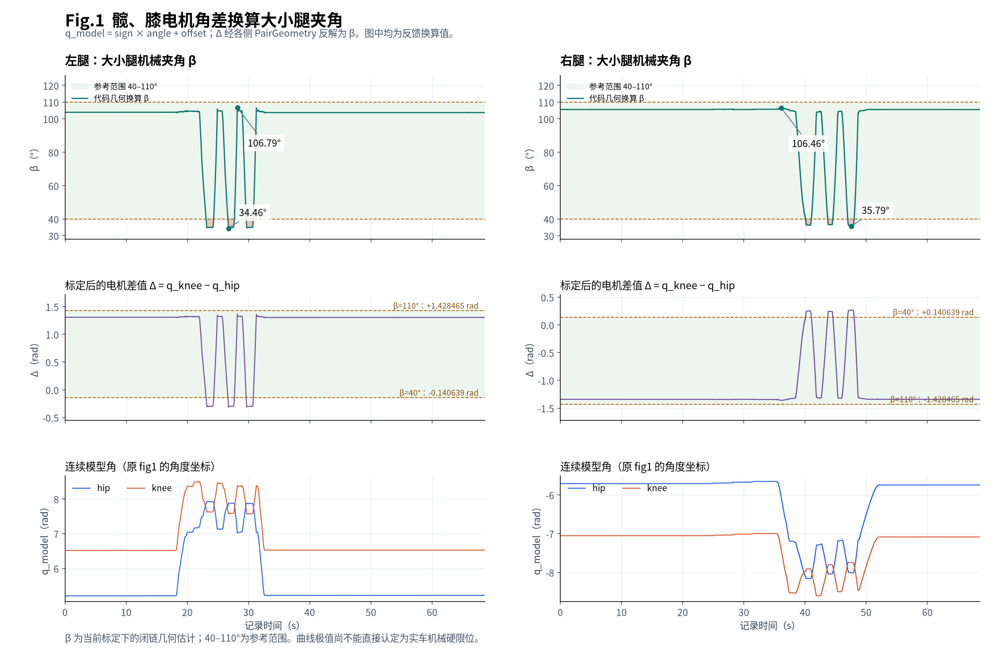

# 髋膝电机角差与大小腿夹角

按当前扫频代码和标定重算本次 CSV，左腿大小腿夹角 β 覆盖 **34.46–106.79°**，右腿覆盖 **35.79–106.46°**。两侧都有低于参考下限 40° 的记录，均未达到参考上限 110°。



## 转换关系

原 fig1 的 hip、knee 曲线读取的是 `/wheel_leg/sweep/{axis}/model_angle`。它们已经过电机方向、零偏、连续角展开和装配分支对齐，计算差值时不再加一遍标定偏置。

从 CSV 的原始驱动 API 字段 `/wheel_leg/{axis}/angle` 出发，标定关系为：

```text
q_phase = model_sign × angle + model_offset
q_model = 按反馈增量连续展开 q_phase，并对齐同侧闭链装配分支
Δ_left  = q_model_left_knee  − q_model_left_hip
Δ_right = q_model_right_knee − q_model_right_hip
β_side  = PairGeometry_side.beta(Δ_side) × 180 / π
```

四路顺序为左髋、左膝、右髋、右膝，`model_sign=[-1,-1,-1,-1]`，`model_offset=[1.6,2.93,-1.6,-2.93] rad`。不考虑整圈分支项时，左侧 `Δ=angle_hip−angle_knee+1.33`，右侧 `Δ=angle_hip−angle_knee−1.33`。实际分析直接使用 CSV 中已经展开的 `model_angle`，避免独立取最短弧或取绝对值造成装配分支错误。

`PairGeometry` 使用 `v6_pair_upstream_zero_geometry_v1 @ 8149afda` 的几何表，先建立保形三次 Hermite 插值，再通过 48 次二分反解 β。左右表方向相反；Δ 与 β 是非线性关系。几何表覆盖 30–120°，超出表域返回无效值，不外推。

| 大小腿参考夹角 β | 左侧 Δ（rad） | 右侧 Δ（rad） |
|---:|---:|---:|
| 40° | −0.140638855 | +0.140638855 |
| 110° | +1.428464858 | −1.428464858 |

计算路径见 [反馈标定与差值计算](../../rmcs_ws/src/rmcs_core/src/identification/wheel_leg_frequency_sweep_controller.cpp#L516)、[PairGeometry 插值与反解](../../rmcs_ws/src/rmcs_core/src/identification/wheel_leg_pair_recording_plan.hpp#L22)、[本入口标定和几何表](../../rmcs_ws/src/rmcs_bringup/config/wheel-leg-joint-limit-probe.yaml#L56)。

## 本次记录结果

| 侧别 | 最小 β | 最小值时间 | 最大 β | 最大值时间 | Δ 的观测范围（rad） |
|---|---:|---:|---:|---:|---:|
| 左腿 | 34.4578° | 26.7280 s | 106.7916° | 28.1620 s | −0.315304 ～ +1.365096 |
| 右腿 | 35.7926° | 47.5580 s | 106.4641° | 36.1390 s | −1.358611 ～ +0.271053 |

左腿有 3417 条、右腿有 2810 条记录低于 40°，均没有高于 110° 的记录。四个夹角极值都出现在 `state=2`（待机）。`probe/low/result`、`probe/high/result` 全程为 0，因此本文件没有自动探测成功的端点记录。

这里给出的是**当前标定下的闭链几何估计及观测范围**。要将这些数值认定为实车机械硬限位，还需要确认相应姿态确实触及机械端点，并用实测大小腿夹角校核标定。仅凭曲线极值不能区分机械止挡、外力停止或标定误差。

## 数据与核对

- 输入为 `/home/noir/膝关节髋关节差值夹角限位数据.csv`，236 列，68188 条完整记录，时间跨度 68.6050 s。
- 尾部另有一条不完整记录（`index=68188`，仅 18 列），分析中排除；完整记录中的首条尚无电机反馈，不参与夹角统计。每侧有效夹角各 68187 条。
- 对每侧全部有效记录独立重算，β 与 CSV 的 `beta_estimate` 完全一致，最大绝对误差为 0 rad；有效标志也完全一致。本文件的有效反馈均在几何表域内。
- 新 fig1 顶行为 β 及 40–110° 参考区间，中行为标定后电机差值 Δ，底行为原 fig1 使用的连续模型角。PNG 与 SVG 同步更新。
- [机器可读结果与输入哈希](limits_mechanical_angle_summary.json) 记录 CSV、标定文件的 SHA-256、样本数量、极值索引及核对误差。

复算入口为 `.script/identification/plot_joint_limit_angles.py`，需要 NumPy、Matplotlib：

```bash
python3 .script/identification/plot_joint_limit_angles.py /home/noir/膝关节髋关节差值夹角限位数据.csv
```
