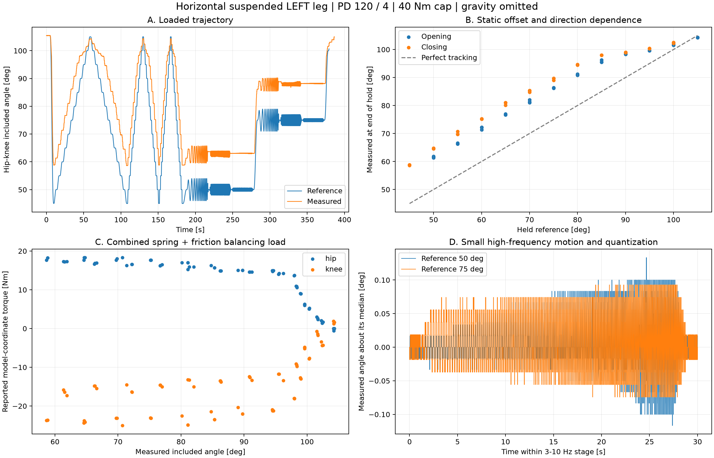

# 水平悬空慢扫分析与下一版动态扫频

操作者确认：腿完全悬空，运动平面水平，本次模型忽略重力。输入为
`/home/noir/大小关节夹角扫频用来测试气簧和单膝关节（慢版）.csv`，
原文件保持不变，SHA256、完整逐段统计和启动力矩候选见 `audit.json`。

## 这份数据支持的结论

243 列、384117 条完整记录，时长 386.354 s；左腿模式 2 的有效扫描记录为 372163 条。
主机 PD 为 120/4，主机和驱动均限 40 Nm。两关节均未出现主机限幅，
反馈力矩绝对峰值为 hip 18.82 Nm、knee 27.92 Nm。
实际夹角覆盖 **58.627–105.463°**；参考降到 45°时，稳定实际夹角约 58.64°。
全程 hip/knee 位置误差 RMS 为 7.29°/8.45°，夹角实际减参考的中位数为 12.66°。
这支持“负载下存在显著 PD 静差”，不支持“40 Nm 已经不够”的解释。

最慢上行中参考 50°时，实际约 61.37°；下行同一参考时，实际约 64.60°。
同一参考并不代表同一实际构型，不能直接把两行力矩差除以二当作摩擦。
3–10 Hz、参考幅值 0.6°的两段高频扫描，实际夹角全范围仅约 0.267°和 0.204°，
需要更强的实际运动激励。记录在最后一个工作点扫描中提前结束，未出现正常完成，
也没有独立验证段或独立叠加力矩探针。

## 水平模型与辨识顺序

保留两个实际运动坐标 q=[q_hip,q_knee]，而不是假设有 PD 就等于髋机械锁死：

`tau_motor = M(q) q_ddot + C(q,q_dot) q_dot + tau_gas(q,history) + B_eff(q) q_dot + tau_friction(q_dot,history)`。

重力项为零。静止时 PD 的 `Kp*(q_ref-q)` 抵消气簧及静摩擦的合负载，
但这是净平衡力矩关系，不能单靠误差拆出惯量、阻尼或气簧系数。
分析应使用实测 q、速度及去重后的反馈时间，不以参考导数代替实际加速度。
逆动力学拟合之后还需保留整段未参与拟合的轨迹做前向预测验证，
依据见 [MIT 系统辨识讲义](https://underactuated.mit.edu/sysid.html)。

1. 慢扫用于拟合随**实际夹角**变化的合负载曲线、方向滞回及启停候选。
   若要用正反向平均/半差分离弹性负载与摩擦，必须匹配实际构型、
   速度幅值和温度；气簧密封滞回仍会进入半差项。
2. 对近零速保持至少 50 ms、随后持续运动至少 20 ms 且实测位移超过 1 mrad 的片段，
   脚本提取启动力矩候选；该数值仍含气簧负载，**不导出纯静摩擦系数**。
   静止时速度反馈存在约 0.022 rad/s 的量化步距，不能把每次速度符号翻转当成启滑。
   参考 [DLR 摩擦实验研究](https://elib.dlr.de/215356/2/final_aeroconf2025_Friction%20Analysis%20of%20the%20Motion%20Suspension%20System%20for%20Improved%20Space%20Robot%20Testing_copyright.pdf)，
   抖动还需区分静摩擦、控制和标定误差。
3. 动态扫描用不同速度/加速度及独立力矩探针，联合辨识位置负载、有效阻尼、有效惯量。
   气簧内部阻尼与传动/关节阻尼在当前传感配置下先作为 `B_eff(q)`；
   不把其整体直接写成独立关节的固定 URDF damping。
4. 编码力矩、发送和反馈时间戳可用于另行拟合命令到电流反馈的延迟/一阶响应，
   需处理非力矩帧、时间对齐和独立验证；位置跟踪相位包含机械和闭环效应。
   完整两关节惯量矩阵继续用模式 3 的两轴独立激励，单膝模式不单独宣称完整 M(q) 已辨识。

操作者提供的旧标定区间：左 34.46–106.79°、右 35.79–106.46°，
是在 110°标定条件下由电机连续差角转换的观测范围。
继续沿用原标定映射，不将 110°线性改写成 106°，也不把受负载的观测端点当作硬限位证明。
本次慢版更没有覆盖 35–58°区域，不能对该区域外推阻尼/惯量。

## 已实现的 v4 模式 2

遥控组合仍为左中、右上。髋角参考保持进入值，纯力矩模式主机 PD 仍为 120/4。

| 阶段 | 参考运动 | 每档采集 |
|---|---|---|
| 进入 | 5 s 平滑到 45° | 一次 |
| 连续开合 | 45–100°，往返 8/4/2 s | 每档 3 次训练 + 3 次独立验证 |
| 局部扫频 | 50/75/95°，幅值 4°，0.15–3 Hz | 各 20 s 训练 + 20 s 不同相位验证 |

总计 224 s；连续开合参考峰值速度约 25.8/51.6/103.1°/s。
不再每 5°停车；反转点的位置、速度和加速度连续。
动态段额外加入总幅值上界 1 Nm 的膝轴独立多正弦力矩探针，髋轴探针为零，
探针在 PD 之后、最终 40 Nm 限幅之前叠加，段首尾平滑归零。
元数据版本为 4，连续开合 `waveform=7`，`validation=1` 是整段保留验证。
旧模式 3 的拟合器兼容版本 3/4；它仍拒绝把模式 2 当作完整两关节模型数据。

45–100°是留有余量的**参考范围**，并非承诺实际跟踪覆盖 45–100°。
提高速度不消除气簧静差；若需要覆盖实际更小夹角，应先验证负载前馈或重新设计保持控制。
本次没有自动套用气簧前馈，也没有把新的 PD 宣称为已优化结果。
模式 1 的低速及 2 s/圈、模式 3 的耦合辨识及高速验证继续保留。
遥控门控、双下复位、40 Nm 限幅及已关闭的周期日志沿用当前实现。

## 复现与验证

分析入口：`.script/identification/analyze_horizontal_knee_sweep.py`。
以 `csv --output-dir reports/leg_sweep_debug/slow_horizontal_20261027` 参数运行，
使用 NumPy、pandas、Matplotlib；图像与 JSON 来自原 CSV，没有修改原始数据。

代码改动集中于 `wheel_leg_sweep_plan.hpp`、`wheel_leg_frequency_sweep_controller.cpp`、
关节扫频 YAML 及测试；插件名称及组件注册沿用现有链路。
当前只进行离线构建、轨迹/采集集成和合成参数回归，未启动实车；
新的实际运动幅值、阻尼/惯量与延迟、最终 PD 和 real2sim 行为仍需新一轮实测验证。

`build-rmcs --packages-select rmcs_core rmcs_bringup` 两包通过；
6 个扫频 CTest 目标、25 个 GTest 用例及 8 个 Python 回归通过。
已检查周期诊断不再输出、正常完成日志保留一次；命令、范围及代码哈希见 `verification.json`。
