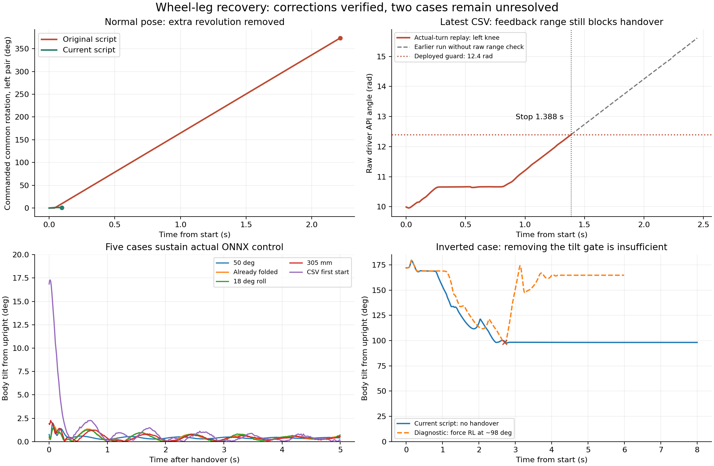

# 自起轨迹修正与自由机身验证（2026-10-22）

**状态：已修正并验证部分轨迹问题，尚未完全解决。** 保留实际编码器累计圈数和现有 DM 范围检查时，最终七工况中五个完成交接并由实际 ONNX 策略保持到仿真结束；最新 CSV 的异向腿位仍被位置反馈范围检查中止，倒扣姿态仍未完成自起。没有启动实车、发送 CAN 命令、改写驱动寄存器或设置电机零点。

## 已落实的控制器修改

- 终点改为**车体坐标系下轮轴前后对齐整车 COM**，使用闭链质量/几何计算；机身受力倾斜不再使目标追随 IMU 重力方向。左右轮距保持资产定义。
- 分离 IK 解有效、实测缩腿完成、允许交接。原来目标轮轴低于 COM 不足 40 mm 就令整个反馈无效的条件，不再用于否定可解目标。最新日志对应的有效目标仅差 0.142 mm 投影距离，旧逻辑却立刻失能。
- 缩腿使用真实闭链轮轴方位。正常腿位已在 COM 下方时直接缩入目标，不再因固定旋向而额外转一整圈；确实需要转位时保留用户指定的固定方向 `-1`，不根据前后位置选择近路。
- 目标膝角 **40.5°**，轨迹速度保留 **3 rad/s**，即原先 1 rad/s 的三倍。实测两膝缩至不大于 42.5° 后开始转位，沿途继续收至目标；交给 RL 时两膝不大于 41°。允许轻微止挡顺应误差，指令不低于 40° 机械止挡。若旋转前就等待不大于 41°，本次负载模型会多等约两秒，因此没有采用该等待方式。
- 轨迹到位后直接将六轴交给策略，混合时间为零，没有脚本伸腿/蹬腿阶段。参考走完后仍检查实际腿位，避免在约 53–55° 时因为参考轨迹完成而提前切段。
- 轨迹模式不再因旧路线的 150 ms 无支撑计时立即终止，也不将倒扣强行标记为 Upright 路线。缩腿和转位阶段轮电机参与现有姿态控制。传感器新鲜度、真实铰链边界、遥控器复位、8 秒超时及既有交接倾角界限仍按当前配置执行。
- 故障日志增加原生错误码、反馈有效标记、原始四电机位置及距离范围检查边界的余量，避免 `feedback_fresh=1 / failure=0` 掩盖退出原因。

控制、闭链运动学、状态机、标定和 PD 均在原生 `WheelLegController` 内；通用 `RlBridge`、ONNX、训练项目和硬件映射未改动。

## 最终 Isaac Sim 6.0 结果

最终结果为 `isaac_acceptance/report.json`，每个工况运行 8 秒。下表中“通过”要求发生交接且实际策略在剩余仿真中持续控制，没有倾角/铰链停止事件。失败后的被动运动不计作策略接稳。

| 初始工况 | 交接/停止时间 | 实测膝角（左/右） | 8 秒结论 |
| --- | ---: | ---: | --- |
| 正常 50°腿位 | 0.097 s | 40.99° / 40.98° | 策略持续控制，末端倾角 0.397° |
| 已折叠 40.5° | 0.043 s | 41.00° / 40.99° | 策略持续控制，末端倾角 0.392° |
| 18°横滚 | 0.274 s | 40.28° / 41.00° | 策略持续控制，末端倾角 0.571° |
| 正常 305 mm 站姿 | 0.143 s | 40.73° / 40.73° | 策略持续控制，末端倾角 0.370° |
| CSV 首次起始，索引 3577 | 2.923 s | 39.97° / 39.97° | 策略持续控制，末端倾角 0.184° |
| CSV 倒扣，索引 6409 | 7.999 s | 40.39° / 40.39° | 原生超时（错误 6），机身 98.17° |
| CSV 最后异向腿位，索引 19349 | 1.388 s | 41.30° / 42.00° | 范围检查停止；之后为被动段 |

五个成功工况交接时，车体系轮轴前后误差均不超过 4.35 mm；全部七工况的闭链最大间隙不超过 0.133 mm。



正常腿位的多余整圈来自旧的缩腿保向与有向终点选取组合；此次修改直接消除了该指令。该仿真支持其是正常姿态失稳的一个机制，但不能据此声称已穷尽实车 180° 翻车的全部原因。

## 仍未解决的两个问题

### 1. 最新 CSV 姿态继续按固定方向转，会先碰到 DM 位置反馈范围检查

按用户指定，核对本地和远端 `dev/wheel_leg_rl`，均为 `0fcc9b45cd80e4dba69c03a1fbed2b848ab5092a`。该分支的默认 `P_MAX=12.5 rad`，反馈驱动使用 16 位线性解码，没有连续位置展开；原分支同样存在 `abs(q_api) >= P_MAX - 0.1` 的拒绝条件，即 **±12.4 rad**。当前驱动和官方 YAML 与该默认定标一致。

制造商的 [官方电机示例](https://github.com/dmBots/motor-sdk/blob/main/Python%E4%BE%8B%E7%A8%8B/u2can/DM_CAN.py) 同样列出 DM8009 的 `[12.5,45,54]` 默认定标。[DM-J8009-2EC V1.0 手册](https://github.com/dmBots/DM-J8009-2EC/blob/master/manual/DM-J8009-2EC%E5%87%8F%E9%80%9F%E7%94%B5%E6%9C%BA%E8%AF%B4%E6%98%8E%E4%B9%A6V1.0.pdf) 说明了可配置映射和各模式共用的位置反馈帧，**没有给出超范围后回绕或饱和的契约**。不能从“输出轴单圈绝对编码器”推断 MIT 反馈按 2π 回绕，也不能擅自按 25 rad 拼接反馈。

补查 CSV 的四次外层退出，右膝 API 位置均在首个失能采样越过该检查值：

| 最后活动索引 → 首个失能索引 | 首个失能时右膝 API 角度 |
| --- | ---: |
| 13535 → 13536 | -12.40310521 rad |
| 13934 → 13935 | -12.40386816 rad |
| 14497 → 14498 | -12.40806439 rad |
| 15565 → 15566 | -12.40157931 rad |

这些样本会被现有代码确定拒绝。CSV 没有部署二进制哈希与具体守卫分支编号，不能把这一定位扩大为对所有 13 次退出的同一种解释：此前还有五次原生错误 1 和四次原生错误 2。

最终重放恢复 CSV 索引 19349 的累计圈数后，在 **1.388 s**，左膝 API 位置达到 **12.40152454 rad**，在交接前停止。此前将物理资产初始化角归一化、只验证闭链/策略的运行绕过了这一层检查；它虽然能在 2.448 s 发出交接并接稳，**不能计作当前默认驱动路径通过**。`dm_range_forecast.json` 和 `isaac_final/` 保留该早期结果，最终验收已用原始圈数修正。

这里是位置反馈表示与连续转腿路径的冲突，不是已确认的机械旋转限位。要闭合此问题，需要确认装车固件的连续位置反馈方式，或使用与固件一致且足够覆盖路径的范围及标定。只改主机 YAML 的 `P_MAX` 会改变解码比例；只在模型坐标减去整圈也不会改变驱动编码器零点，因此都没有作为实车修复。

### 2. 倒扣姿态不能靠放宽交接倾角解决

最终原生轨迹能将腿收至约 40°并对齐车体 COM，但机身停在约 98°倾角，8 秒超时。对同一倒扣起始另做诊断对照：允许任意倾角交接、去掉交接后的 45°倾角停止条件，在 2.702 s、98.25°时强交给同一实际策略；6 秒结束时倾角为 **164.67°**，仍未扶正。

恢复重力坐标终点、额外同向转一圈、允许轮姿态控制跨过现有 55°工作界限等报告内对照，也都没有完成倒扣自起。这些诊断改动没有进入生产控制器。现有结果只证明该轨迹/策略组合在此模型与起始状态失败，不能据此宣布策略在所有倒地状态下都不可能恢复。

完整倒扣还需要能够改变机身姿态的腿轮协同恢复动作或经过倒地状态验证的恢复策略；本次没有启动训练，也没有用取消守卫掩盖失败。

## 验证范围与复现

- 构建：通过仓库 `.script/build-rmcs --packages-select rmcs_core rmcs_bringup`。
- 回归：3 个 CTest 组、21 个 GTest 用例通过。`colcon test-result` 合并显示 24 条测试记录，错误/失败/跳过均为零。见 `build_and_tests_acceptance.log`。
- 仿真：Isaac Sim 6.0.0.1 / IsaacLab 3.0 beta2，CPU PhysX，1 ms 步长。机身六自由度释放，有地面接触和六个实际闭链约束，只初始化一次状态。直接编译本次原生 C++，动态生成 IMU，使用现有支撑观测器。
- 策略：部署的 `recovery_candidate.onnx`，SHA256 `a00d13df1d4113fe949c2a6a15b508e5c491fd1a5e6881570bf025a8d3c29c29`。35 维 YAML 顺序/缩放、50 Hz 影子推理、原生有向关节展开与有效动作历史、1 kHz PD；交接后六轴由实际策略输出驱动。
- 范围检查：从官方 YAML 读取电机映射/偏置和范围，恢复 CSV 的原始整圈偏移，在成对角度展开前复现原生范围检查。另行去掉 PhysX 旋转关节坐标的整圈跳变，以连续物理转角还原编码器零点；这只是仿真坐标处理，不是对 DM 固件回绕行为的假设。其他 ROS 工作线程时序和完整传感器传输链不由此独立适配器验收。
- 边界：零初始速度、CAD 质量/COM、目录气弹簧先验曲线、理想限幅力矩（腿 40 Nm、轮 4.5 Nm）。资产全局过滤自碰撞，**未验证整圈对机身的实际运动间隙**。没有 DM 延迟、实际转矩转速/功率包络、传动柔性、实车标定偏差与 ROS/CAN 时延；不能当作实车通过。

输入 CSV 为 `/home/noir/wheel_leg_rl_2026-10-21_17-56-31.csv`，SHA256 `23aaf4e6eae10ec722ea6b1406860eb7c7ceb8762d18c9acd08139cf6bf9c565`。索引 18995 的一膝为 107.0038°，略超资产 107°刚性止挡，因此完整物理起始采用同组第二次索引 19349，没有剪裁超限角度伪造重放。

在 RMCS 仓库根目录执行：

```sh
bash reports/wheel_leg_recovery_fix_20261022/build_probe.sh
OPENBLAS_NUM_THREADS=1 OMP_NUM_THREADS=1 MKL_NUM_THREADS=1 OMNI_KIT_ACCEPT_EULA=YES \
/home/noir/miniconda3/envs/isaaclab6/bin/python \
reports/wheel_leg_recovery_fix_20261022/probe_freebody.py \
--library reports/wheel_leg_recovery_fix_20261022/libfreebody_final.so \
--output reports/wheel_leg_recovery_fix_20261022/replay \
--seconds 8 --policy --motor-range-guard
```

最终数据在 `isaac_acceptance/`；参考分支/手册核对在 `dm_defaults_reference.json`；四次外层退出切片在 `dm_range_hardware_exits.json`；来源与最终记录校验在 `validation_provenance.json`。其余 `isaac_*comparison/` 为诊断对照，`isaac_v1/v2`、`isaac_policy_v2`、`isaac_final`、`isaac_with_motor_range`、`isaac_final_with_motor_range`、`isaac_acceptance_before_asset_unwrap` 为保留的中间版本，均不替代最终结论。
